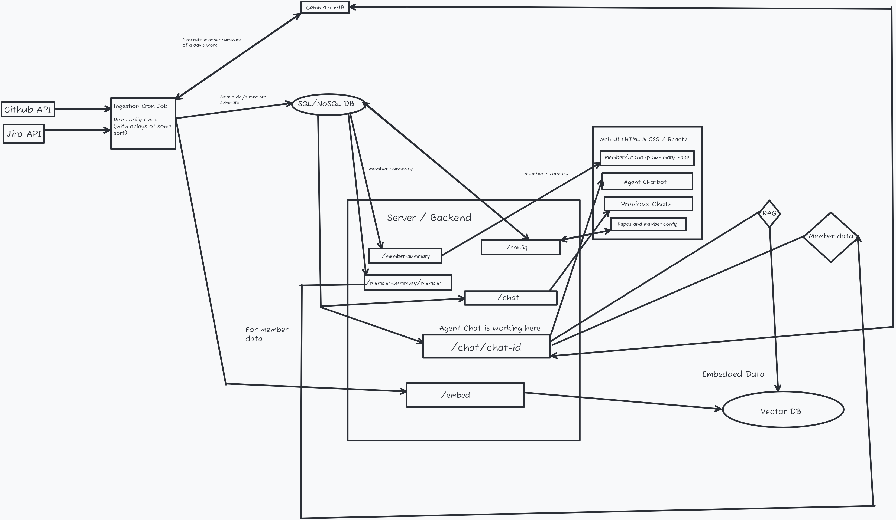

# Roll-Call

Roll-Call is an AI team-reporting agent. It automatically ingests your team's daily
activity from **GitHub** (pull requests, commits, direct pushes) and **Linear** (issues,
comments), generates a plain-English standup summary per member with an open-weight
**Gemma** model, stores everything in **MongoDB Atlas**, and exposes it through a chat
interface where an agent — grounded in the ingested data via RAG — answers questions
about who worked on what, and when.

## Architecture



*(Source: `architecture/system-data-flow-design.png`)*

## How it works

1. **Ingestion** (`ingestion/`) — a scheduled GitHub Actions workflow runs nightly at
   01:00 UTC (reporting the completed previous day):
   - `github.py` walks open PRs per repo, marking the ones touched today (commits,
     reviews, merges) vs. ongoing; direct pushes to the default branch are kept separately.
   - `linear.py` pulls issues touched today plus active assigned issues (ongoing work),
     with today's comments.
   - `llm.py` cross-links issues to PRs, assembles one payload per member, and asks
     **Gemma** (run locally, via `litellm`) to write the daily summary.
   - `db.py` upserts the result into MongoDB Atlas (`roll_call` DB, `daily_reports`
     collection) — repos, team members, and reports all live there.
   - `ingestion.py` then POSTs each report to the backend's `/embed` endpoint, which
     uploads it as a document to **Backboard** — the agent's memory and RAG store.
2. **Backend** (`backend/`) — a FastAPI API (the only thing the browser talks to):
   - JWT auth (register/login), per-IP rate limits and per-user quotas.
   - Config endpoints to manage tracked repos and team members.
   - Read endpoints for member daily summaries.
   - Chat endpoints backed by a **Backboard** thread per chat — the assistant answers
     grounded in the uploaded member documents (RAG), with a `get_daily_summaries`
     tool that queries live reports from MongoDB.
   - `/embed` — machine-to-machine endpoint (shared `X-Service-Token` secret) used by
     the ingestion pipeline; re-ingests idempotently (replaces, never duplicates).
3. **Frontend** (`frontend/`) — plain HTML/CSS/vanilla JS (no build step): login /
   register, daily-summaries dashboard, config, and chat pages, with vendored
   `marked` + `DOMPurify` for sanitized markdown rendering of LLM output.

## Tech stack

| Technology | Role |
|---|---|
| [Render](https://render.com) | Hosts both the backend (web service) and the frontend (static site) — `render.yaml` defines both |
| [Gemma](https://ai.google.dev/gemma) (open-weight) | Standup ingestion LLM — runs **locally** (via `litellm`) to summarize each member's day, and is also used via **OpenRouter** for the chat agent |
| [Backboard](https://backboard.io) | The agent's memory and RAG — ingested data from Linear and GitHub is uploaded as documents; chats run on Backboard threads |
| [GitHub](https://github.com) + GitHub Actions | Automated data ingestion pipeline (nightly cron) and deployment pipelines (deploy hooks fire per push to `main`) |
| [MongoDB Atlas](https://www.mongodb.com/atlas) | Primary database for the app (repos, team members, daily reports, users, chats) — shared by ingestion and backend |
| [Sentry](https://sentry.io) Agent Tracing | Added to the ingestion Gemma model (via the `litellm` integration) and to the Backboard chat client (custom span instrumentation) |

## Repository structure

```
ingestion/     GitHub + Linear collectors, Gemma LLM layer, MongoDB storage, /embed hook
backend/       FastAPI app — auth, config, summaries, chats, /embed, Backboard client
frontend/      Static multi-page UI (summaries, config, chats, login/register)
architecture/ System data-flow design (png / svg / drawy)
.github/       Workflows: nightly ingestion + backend/frontend deploy hooks
render.yaml    Render Blueprint — both services
```

## Deployment

Deployed on Render via GitHub Actions deploy hooks (auto-deploys are off — pushes to
`main` trigger the matching workflow, which fires the service's hook). One-time setup
instructions are in [DEPLOY.md](DEPLOY.md); the ingestion workflow's required secrets
and variables are documented in
[`.github/workflows/daily-ingestion.yml`](.github/workflows/daily-ingestion.yml).

## Running locally

- **Ingestion**: `cd ingestion && pip install -r requirements.txt`, copy `.env.example`
  to `.env` (GitHub PAT, Linear token, Mongo connection string, LLM key/model/base URL,
  optional `SERVICE_TOKEN` + `BACKEND_EMBED_URL`), then `python ingestion.py`.
- **Backend**: `cd backend && pip install -r requirements.txt`, copy `.env.example` to
  `.env`, then `uvicorn app.main:app --port 8787`.
- **Frontend**: serve `frontend/` statically (`js/config.js` holds the single
  `API_BASE` setting — point it at `http://localhost:8787` for a local backend);
  `frontend/temp-mock/serve.py` is a mock API for frontend-only work.

Detailed design decisions live in [`backend/PLAN.md`](backend/PLAN.md) and
[`frontend/PLAN.md`](frontend/PLAN.md).
